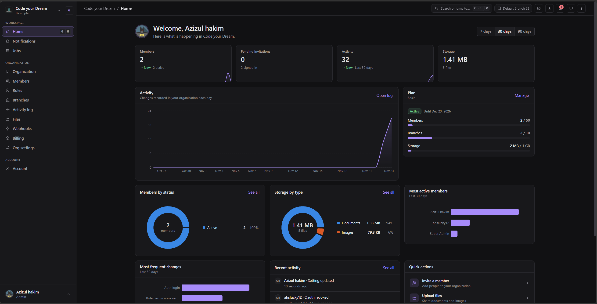
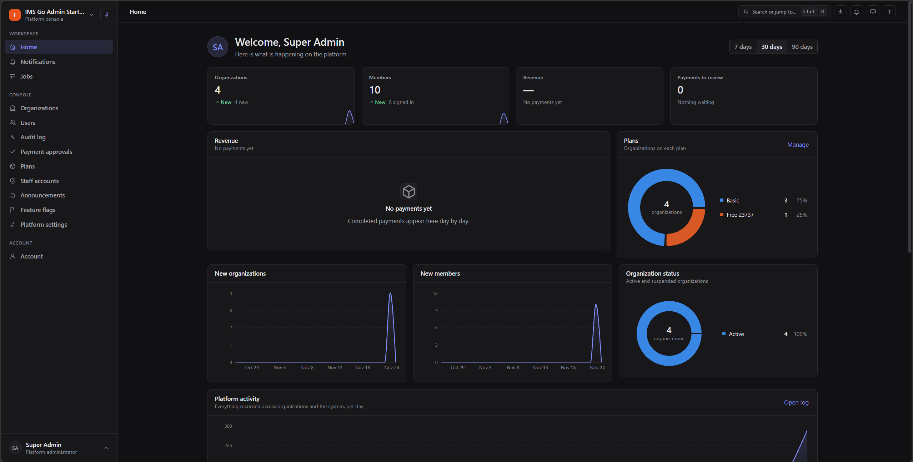
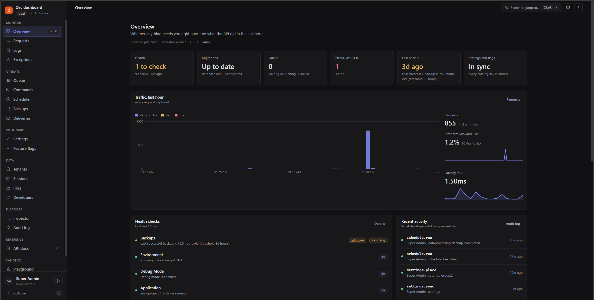
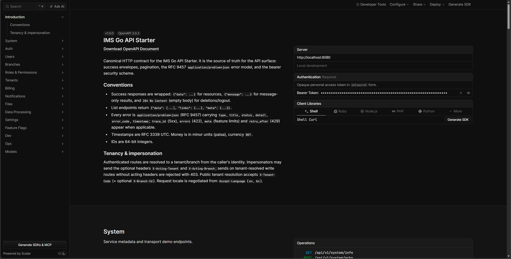
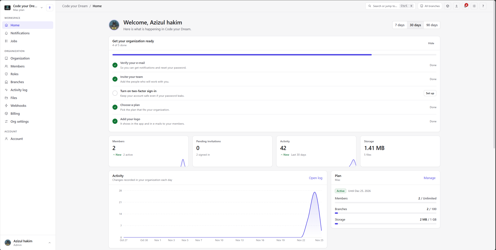
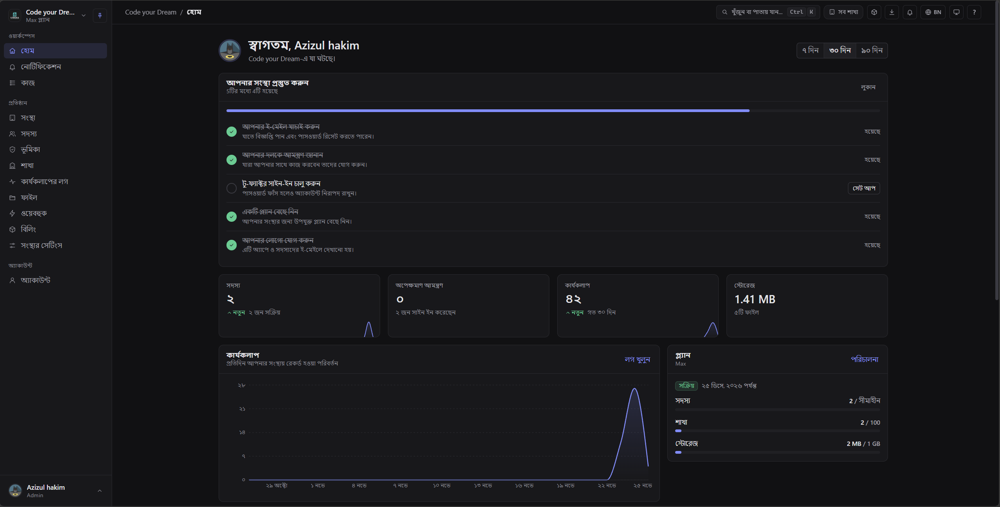
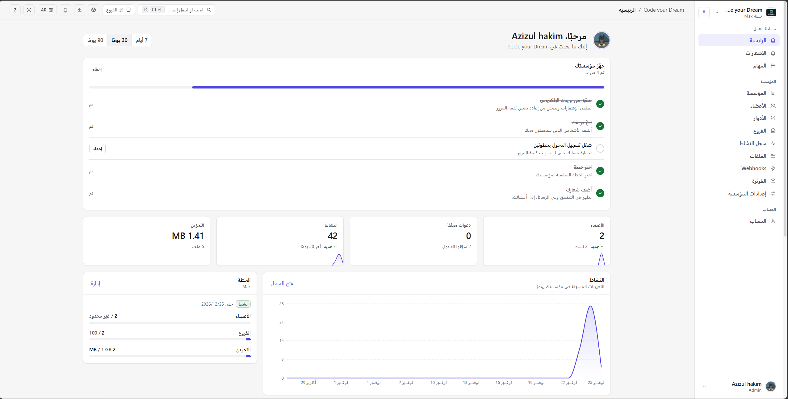
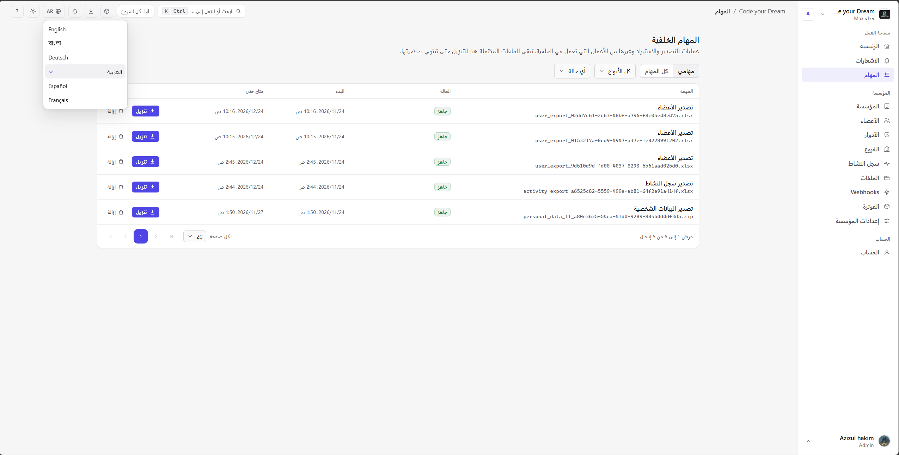
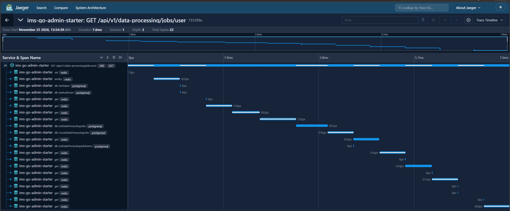

#  IMS Go SaaS Kit

[](https://github.com/Innovix-Matrix-Systems/ims-go-saas-kit/actions/workflows/ci.yml)

[](https://ims-go-saas-kit.innovixmatrixsystem.com)
[](https://github.com/Innovix-Matrix-Systems/ims-go-saas-kit/generate)
<br>


**A multi-tenant SaaS admin, ready to build on.** IMS Go SaaS Kit is a
multi-tenant Go backend together with the app your customers and your staff actually use: an
organization workspace (members, roles, billing, files, dashboards) and a staff console (organizations, plans, payments, announcements, audit), in six
languages (Arabic right to left), light or dark. It ships as **one CGO-free binary** that serves the app at `/`, the API,
the developer dashboard at `/dev` and the API reference at `/docs`, and runs migrations, queue
workers and the scheduler. No containers required, Docker-ready when you want it.

**📖 Documentation:** **[ims-go-saas-kit.innovixmatrixsystem.com](https://ims-go-saas-kit.innovixmatrixsystem.com)**. Start with the
[quick start](https://ims-go-saas-kit.innovixmatrixsystem.com/getting-started/quick-start/), build
[your first feature](https://ims-go-saas-kit.innovixmatrixsystem.com/tutorial/first-module/) from the table to the screen,
see [every screen of the app](https://ims-go-saas-kit.innovixmatrixsystem.com/app/overview/), or read
[coming from Laravel](https://ims-go-saas-kit.innovixmatrixsystem.com/getting-started/coming-from-laravel/). The same pages are
in [`docs/`](docs/README.md) as Markdown; the links in the tables below point there.

| Organization dashboard | Staff console |
| --- | --- |
|  |  |

| Developer dashboard (`/dev`) | API reference (`/docs`) |
| --- | --- |
|  |  |

| Light mode | বাংলা (Bangla) |
| --- | --- |
|  |  |

| العربية (Arabic, right to left) | Six languages, one menu |
| --- | --- |
|  |  |

**Every request traced with OpenTelemetry**: one call, its Redis commands and SQL queries, timed
([Tracing](docs/guides/health-and-observability.md#tracing-opentelemetry)).



## Why

- **Start from a product, not a blank page.** Sign-up, onboarding, a workspace per organization,
  billing with plan limits and a console for your team already work together; you add your own
  modules and screens.
- **One codebase, one binary.** The API, the app and both dashboards change in the same pull
  request and deploy as one `ims` binary; the app's API types are generated from the same spec the
  server is checked against.
- **Multi-tenant and safe by default.** Tenant and branch isolation in SQL (fails closed), a
  permission on every route, staff impersonation and "log in as" recorded in the audit log.
- **Built the Go way, with Laravel's batteries.** Thin handlers, permissions on routes, typed SQL
  (sqlc), explicit wiring, a queue and a scheduler, `ims gen module` for a new feature.
- **AI-ready.** An MCP server that Claude, ChatGPT, Cursor or OpenCode add as a connector, under
  the same permissions, and agent skills (`.agents/skills`) that know the codebase.

## The app

**For an organization** (members see what their role allows):

| Area | What it does |
| --- | --- |
| Home | A dashboard per role: members, invitations, activity trend, storage by type, plan usage, the most active members and frequent changes, quick actions and a getting-started checklist |
| Members & access | Invite, edit, deactivate, reset two-factor, export; roles with permissions; branches with a switcher |
| Organization | Profile with logo, contact details and owner (transfer ownership); preferences grouped by area (notifications, e-mail branding, security, privacy) |
| Billing | Plans with limits, checkout by bank transfer, payments and invoices, usage at a glance and a banner when the plan needs attention |
| Files & jobs | Files in a grid or list with previews; exports and imports run in the background with progress, retry and download until they expire |
| Activity, webhooks, notifications | The organization's audit log with filters and export, webhook subscriptions, a notification bell and page, staff announcements as banners |
| Account | Profile and photo, password, two-factor (app or e-mail codes), signed-in devices, notification preferences, personal-data export and account deletion |

**For your staff** (the console):

| Area | What it does |
| --- | --- |
| Overview | Organizations, members, revenue, payments to review, plans and the newest organizations |
| Organizations & users | Search, open, suspend, change plan, impersonate an organization or log in as a user |
| Billing | Payment approvals and the plan catalog |
| Announcements | One announcement to every organization or chosen ones: a notice, warning or promotion with a button, a schedule, optional e-mail or push, and views, clicks and closes per organization |
| Platform | The system audit log with export, staff accounts, feature flags and platform settings |

Throughout: sign-up and a setup wizard, Ctrl+K to jump anywhere, keyboard shortcuts, accent and
density presets, and layouts that work on a phone.

## The API and platform

| Area | What you get | Guide |
| --- | --- | --- |
| Auth | Login with OTP, two-factor, invitations, password reset, e-mail verification and change, revocable sessions, personal access tokens, social login (Google, GitHub) | [Authentication](docs/guides/authentication.md) |
| Access & tenancy | RBAC with a permission catalog, tenants and branches isolated in SQL, staff acting as a tenant or a user (audited) | [Permissions](docs/guides/permissions.md) · [Tenancy](docs/guides/tenancy.md) |
| Billing | Plans with feature limits, self-service subscription, bKash, cash and bank payments with approvals | [Billing](docs/guides/billing.md) |
| Product | Settings, feature flags, notifications (feed, mail, SMS, push), announcements, import/export, dashboards | [Settings](docs/guides/settings.md) · [Notifications](docs/guides/notifications.md) |
| Files & audit | Local, S3, R2 or MinIO storage; activity log, system audit log, request telemetry | [Files](docs/guides/files-and-storage.md) · [Activity log](docs/guides/activity-log.md) |
| Background | River queue, cron scheduler, backups, webhooks with signatures and retries | [Queue](docs/guides/queue-and-scheduler.md) · [Webhooks](docs/guides/webhooks.md) |
| AI agents | MCP server as a connector, OAuth 2.1, tools from OpenAPI `x-mcp` | [MCP](docs/guides/mcp.md) |
| Operations | RFC 9457 errors, OpenAPI 3 with a contract check, health probes, Prometheus metrics, OpenTelemetry tracing, maintenance mode, systemd or Docker deploy | [Observability](docs/guides/health-and-observability.md) · [Deploy](docs/operations/deploy.md) |

## Quick start

<!-- rename:keep -->
Building a product on it? Press **[Use this template](https://github.com/Innovix-Matrix-Systems/ims-go-saas-kit/generate)** on GitHub to get a repository of your own
(clean history, not a fork), clone it, and give it your names in one step:

```bash
make rename MODULE=github.com/acme/shop-admin BINARY=shop TITLE="Acme Shop"   # DRY=1 to preview
git add -A && git commit -m "chore: rename the kit to shop-admin"
```

That rewrites the Go module path, the binary and CLI name, the deploy names and paths, the
display title and the `IMS_` deploy variables, renames the systemd units, and regenerates code and
docs. Seeded e-mails and the credits are left alone.
<!-- rename:end -->

```bash
cp .env.example .env          # local configuration (git-ignored)
make tools                    # air + golangci-lint (once)
npm --prefix web/dev ci       # developer dashboard dependencies (once)
npm --prefix web/app ci       # client app dependencies (once)
make db-up                    # Postgres via docker compose — or point DATABASE_DSN at your own
make migrate seed             # schema, permissions, a tenant, roles, a staff and a developer account
make dev                      # app :8082, developer dashboard :8080/dev, API :8081, hot reload
```

| Open | Sign in as |
| --- | --- |
| **<http://localhost:8082>**, the app | `superadmin@ims.com` for the staff console; **Create an organization** on the sign-in page for an organization of your own |
| **<http://localhost:8080/dev/>**, the developer dashboard | `developer@ims.com` or `superadmin@ims.com` |
| **<http://localhost:8081/docs>**, the API reference | |

The seeded password is `123456` (`AUTH_DEFAULT_PASSWORD`). Run `make queue` and `make schedule` in
two more shells for background jobs (exports, e-mail) and scheduled tasks (announcements, renewals).
Prefer containers? `docker compose up -d --build` runs Postgres, the API, the worker and the
scheduler from one image (see [Docker](docs/operations/docker.md)).

## Build a feature

A feature is a backend module and, if people use it, a screen in the app:

1. **Module:** `go run ./cmd/app gen module --name=product --fields="name:string,price:decimal"`
   scaffolds the migration, queries, service, handler, routes with permissions, tests and the
   OpenAPI entry. See the [module guide](docs/guides/modules.md).
2. **Screen:** add a route in `web/app/src/routes/`, run `npm --prefix web/app run openapi:gen` for
   typed API calls, and add it to the sidebar and Ctrl+K in `web/app/src/components/navigation.ts`.
   Reuse the components in `web/app/src/components` and add its text in every language
   (`web/app/src/i18n/catalogs/`, checked by `npm run i18n:check`). See [Adding a screen](docs/app/adding-a-screen.md).

The [first-feature tutorial](docs/tutorial/first-module.mdx) does both, end to end, in about 45
minutes.

[AGENTS.md](AGENTS.md) is the working guide for both, for people and AI agents.

## Commands

```bash
make help               # every target
make check              # gofmt + vet + lint + unit tests
make test-integration   # full suite (needs DATABASE_TEST_DSN)
make generate           # sqlc + OpenAPI code + generated regions
make gen-check          # generated code, docs and skill copies are current
make app-openapi-check  # the client app's API types are current
make build-all          # developer dashboard + client app + bin/ims
```

The binary is the CLI too: `ims serve | queue:work | schedule | migrate | db:seed |
permission:sync | key:generate | backup:run | down | up | gen module | ...`.

Requires PostgreSQL 16+, Go 1.26.11+ and Node.js 20.19+ (the app and the developer dashboard).
Every setting lives in `.env` (documented in `.env.example`; `ims config:show` prints the effective
values with secrets masked).

## License

This project is licensed under the [MIT License](LICENSE.md).
