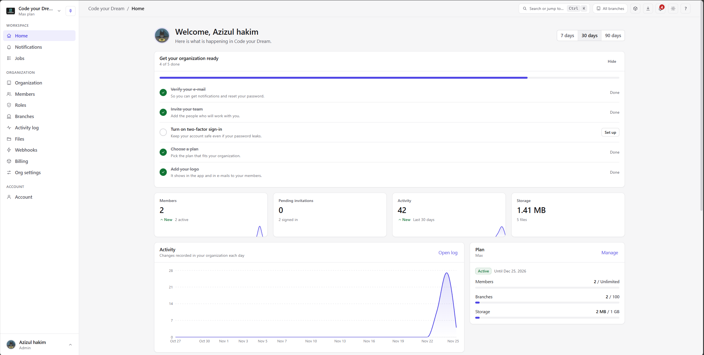
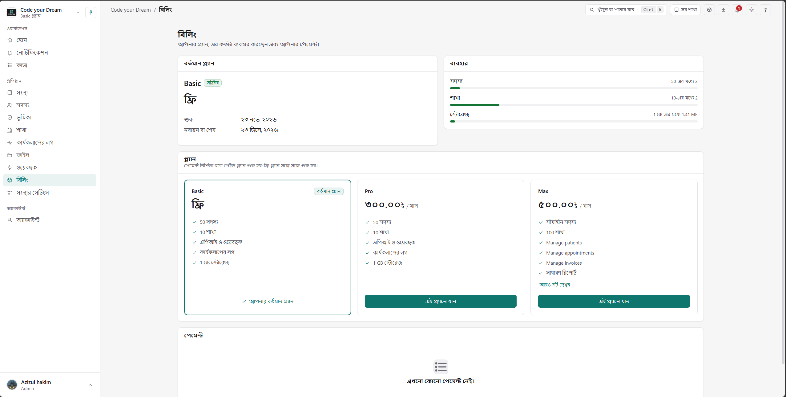

When someone from an organization signs in, they land in its workspace. Each page in the sidebar
appears only when their role grants the permission next to it; the API checks the same permission
on every call, so the sidebar is a convenience, never the security boundary.

## Pages

| Page | Path | What it does | Needs |
| --- | --- | --- | --- |
| Home | `/` | a dashboard for the member's role: members, invitations, activity trend, storage by type, plan usage, the most active members, frequent changes, quick actions and a getting-started checklist | — |
| Notifications | `/notifications` | the notification feed, newest first, with read and unread | — |
| Jobs | `/jobs` | exports and imports in the queue: progress, retry, download until the file expires | — |
| Organization | `/org` | profile with logo, contact details and owner | — |
| Members | `/org/members` | invite by e-mail, edit, deactivate, reset two-factor, export the list | `user.view.all` |
| Roles | `/org/roles` | roles and their permissions, grouped by area | `role.view.all` |
| Branches | `/org/branches` | the organization's branches (shops, offices, clinics) and their managers | `branch.view.all` |
| Activity log | `/org/activity` | every recorded change, filterable by person, action and date, with export | `activity.view` |
| Files | `/org/files` | uploads in a grid or list, with previews for images, video, audio and PDF | `file.view.all` |
| Webhooks | `/org/webhooks` | endpoint subscriptions, the signing secret, a test event and recent deliveries | `webhook.manage` |
| Billing | `/org/billing` | the current plan and account credit, usage against limits, plans to switch to with the price of the change (unused days credited), renew or stop the renewal, checkout and payments | `billing.view` |
| Org settings | `/org/settings` | preferences grouped by area (notifications, e-mail branding, security, privacy) and ownership transfer | — |
| Account | `/settings/…` | profile and photo, password, two-factor, signed-in devices, notification preferences, connected AI apps, data export and account deletion | — |

A page's *buttons* check finer permissions: on Branches, **New branch** needs `branch.create`, and
a member with only `branch.view.all` sees each branch as read-only details instead of a form.
The full list of permissions is in the [permissions reference](../reference/permissions.md).

## Branches in the top bar

An organization with more than one branch gets a **branch switcher** in the top bar. A member works
in one branch at a time, and branch-scoped lists (files, activity, your own modules) show that
branch; **All branches** shows everything the member may see. The choice is stored on the account,
so it follows the member to another device. See [Tenancy](../guides/tenancy.md#lists-by-branch).

A product whose organizations never need a second branch sets `branchesEnabled` to `false` in
`web/app/src/product.ts` and gives every plan `branches.max` = 1: the app then hides the branch
page, its dashboard shortcut, the branch count and the branch limit on plans and usage, and every
organization works in its default branch.

## Plan limits

Plans limit members, branches, storage and any feature you add. When an action would cross a limit
the API answers **402** with the limit in `meta`, and the app explains it and links to Billing. A
banner in the shell says when the plan is about to expire or needs payment. When a paid plan has
lapsed, the banner counts down the grace period, then says the organization is read-only: members
can still view, copy and export, and paying lifts it. Billing and onboarding offer each plan monthly
or yearly. See [Billing](../guides/billing.md#grace-and-read-only).

## Getting started checklist

New organizations see a checklist on Home: verify your e-mail, invite your team, turn on
two-factor, choose a plan, add your logo. Each item completes itself when the work is done, and
the owner can hide the card. Change the items in `src/components/GettingStarted.tsx`.

## Announcements

Banners at the top of the shell carry announcements from your staff (a notice, a warning or a
promotion, with an optional button). Members can close them, and staff see views, clicks and
closes per organization. See [Staff console](./staff-console.md#announcements).
