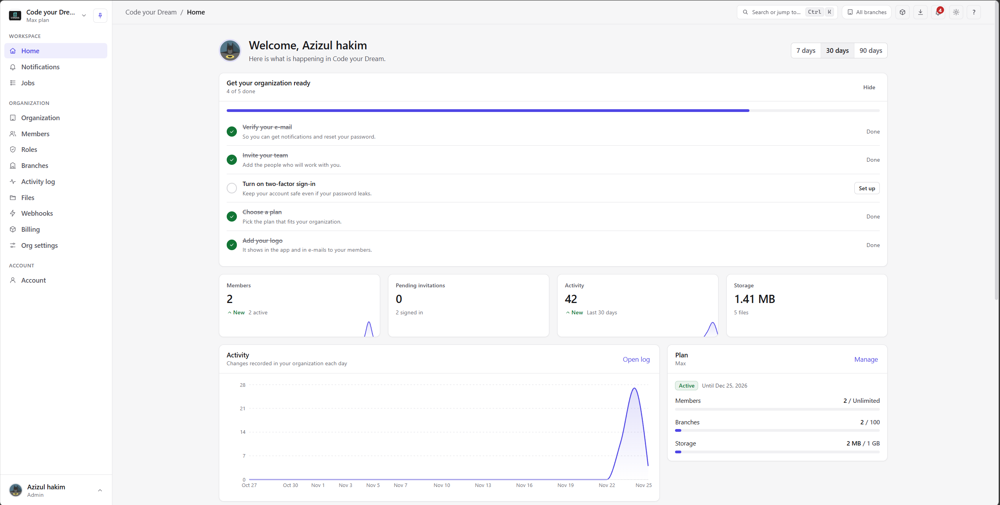

The kit ships a complete web app at `/`, next to the API. One codebase serves two audiences:

- **Organizations** (your customers): a workspace per organization with members, roles,
  branches, billing, files, webhooks and an activity log. See
  [Organization workspace](./organization-workspace.md).
- **Your staff**: a console for every organization on the platform, plans and payment approvals,
  announcements, feature flags and the system audit log. See [Staff console](./staff-console.md).

Who sees what is decided by the signed-in account: an account that belongs to an organization
gets the workspace; a staff account (no organization) gets the console, and can step into any
organization from it. Within each, the permissions the API grants decide which pages and buttons
appear.



## How it is served

| | Development | Production |
| --- | --- | --- |
| Where it runs | Vite dev server on **:8082** with hot reload (`make dev`) | built into `web/app/dist` and **embedded in the `ims` binary** |
| How it reaches the API | Vite proxies `/api`, `/docs`, `/storage` to the API on :8081 | same origin: the binary serves the app at `/` and the API at `/api/v1` |
| Build | — | `make app-build` (the release build runs it) |

The app owns every path except the ones the server reserves (`/api`, `/dev`, `/docs`,
`/storage`, `/mcp`, `/oauth`, `/.well-known`, `/metrics`, `/up`); an unknown path under those is a
JSON 404 from the API, anything else returns the app's HTML so deep links work. The HTML carries a
strict Content-Security-Policy: the app loads only its own scripts and styles and talks only to
its own origin.

## The stack

| Concern | Library | Where |
| --- | --- | --- |
| Routing | TanStack Router, file-based, code-split per route | `web/app/src/routes/` |
| Server state | TanStack Query (one retry for network and 5xx errors only) | `src/query.ts` |
| API calls | a small typed `fetch` wrapper | `src/api/client.ts` |
| API types | generated from `api/openapi.yaml` by openapi-typescript | `src/api/schema.d.ts` |
| Tables, forms | TanStack Table and Form, plus the kit's own `Field`, `Select`, `DatePicker` | `src/components/` |
| Charts | Recharts, coloured by theme tokens | `src/components/charts.tsx` |
| Text | a typed catalog per language (English, Bangla) | `src/i18n/` |
| Styles | plain CSS on design tokens; no CSS framework | `src/styles/` |

React 19, TypeScript and Vite. There is no global state library: the server is the state, and
TanStack Query caches it.

## How a screen talks to the API

Every call goes through `api()` in `src/api/client.ts`:

```ts
const branches = useQuery({
  queryKey: ['branches', query, page],
  queryFn: () => api<Page>('/branch', { envelope: true, query: { search: query, page } }),
})
```

It adds what every request needs, so screens never do:

- `Authorization: Bearer …` from the stored token, and `Accept-Language` from the chosen
  language, so server messages come back translated.
- The **acting headers** (`X-Acting-Tenant`, `X-Acting-User`) while staff are inside an
  organization or logged in as a user.
- An `Idempotency-Key` when the call passes `idempotent: true`, so a double-clicked create or
  payment runs once.
- It unwraps `{data: …}` (pass `envelope: true` to keep `links` and `meta` for paging).

Errors arrive as an `ApiError` with the RFC 9457 fields: `status`, `code`, per-field `errors` for a
422, `meta` for plan limits on a 402, `retryAfter` on a 429 and the `traceId` to quote in a support
ticket. Answers that change the whole app are turned into app-wide events instead: a 401 signs the
user out, `TWO_FACTOR_SETUP_REQUIRED` opens the setup screen, `TENANT_SUSPENDED` and
`MAINTENANCE_MODE` show their status screens.

The token lives in `sessionStorage` (this tab only) unless the user ticks **Keep me signed in**,
which uses `localStorage`. It is never put in a URL.

## Signing in and the screens outside the app

Routes outside the signed-in area handle the account lifecycle. Each maps to an API flow
described in [Authentication](../guides/authentication.md) and [Sign-up](../guides/sign-up.md):

| Route | Purpose |
| --- | --- |
| `/login` | e-mail and password, then a second factor (authenticator app or e-mail code) when it is on |
| `/signup` | create an organization and its owner account, then the setup wizard |
| `/onboarding` | the setup wizard: choose a plan, invite your team, protect your account |
| `/forgot-password`, `/reset-password` | password recovery by e-mailed link |
| `/verify-email`, `/confirm-email-change` | links from verification and e-mail change messages |
| `/accept-invitation` | an invited member sets a password and joins |
| `/setup-two-factor` | shown when the organization requires two-factor and the account has none |
| `/suspended`, `/maintenance` | status screens for a suspended organization or maintenance mode |

Everything else sits under the `_app` layout route (`routes/_app.tsx`), which loads the session
(profile and permissions) before any page renders, so a page can rely on `useSession()`.

## Throughout the app

- **Ctrl+K** opens a palette of every page and action you can reach; `g` followed by a page's
  letter jumps to it, `?` lists every shortcut.
- **Appearance** per browser: light, dark or system theme; five accent presets (indigo, blue,
  teal, violet, slate); comfortable or compact density.
- **Language**: English and Bangla, switched from the account menu. See
  [Translations and theming](./translations-and-theming.md).
- **Live updates**: when the API's realtime stream is on, notifications, jobs and announcements
  arrive as they happen; otherwise screens poll. See [Live updates](../guides/realtime.md), which
  also shows how to [give your own feature live updates](../guides/realtime.md#adding-live-updates-to-your-feature).
- **Background jobs**: exports and imports run in the queue; a tray in the top bar shows their
  progress and a download link when they finish.
- **Phone layouts**: the sidebar collapses to a drawer and tables scroll inside their card.

## Where the code lives

```text
web/app/
├─ src/
│  ├─ api/          client.ts (the fetch wrapper) · schema.d.ts (generated)
│  ├─ auth/         session.ts: sign-in, the session query, can()
│  ├─ components/   the shell, navigation.ts, ui.tsx, form.tsx, charts.tsx, …
│  ├─ i18n/         en.ts (reference) · bn.ts · index.ts
│  ├─ routes/       one file per screen; routeTree.gen.ts is generated
│  └─ styles/       tokens.css · base.css · components.css · screens/
├─ embed.go         embeds dist/ in the Go binary
└─ package.json     dev · build · typecheck · check:style · openapi:gen
```

Ready to build one? [Adding a screen](./adding-a-screen.md) walks through it, and the
[first-module tutorial](../tutorial/first-module.mdx) gives its products module a screen.
