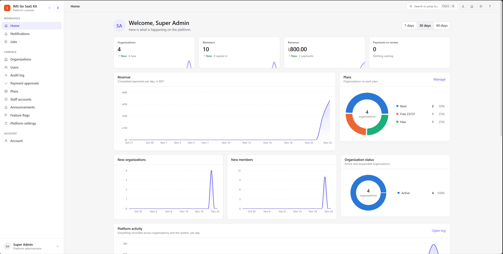

Staff accounts belong to no organization. When one signs in, the app shows the **console**
instead of a workspace: the whole platform, every organization on it, and the tools to support
them. The seeded `superadmin@ims.com` is a staff account.

## Pages

| Page | Path | What it does | Needs |
| --- | --- | --- | --- |
| Home | `/` | organizations, members, revenue, payments to review, plans, organization status and platform activity | — |
| Organizations | `/console/organizations` | search, open, suspend or reactivate, change plan, impersonate | `tenant.view.all` |
| Users | `/console/users` | every account on the platform; open one and log in as them | `user.view.all` |
| Audit log | `/console/activity` | the system audit log across organizations, including every impersonation, with export | `activity.view.all` |
| Payment approvals | `/console/approvals` | bank transfers and cash payments waiting for a decision | `payment_approval.view.all` |
| Plans | `/console/plans` | the plan catalog: prices, features and limits | `package.view.all` |
| Currencies | `/console/currencies` | how amounts are written (symbol, position, decimals, separators) and the default currency | `currency.view.all` |
| Staff accounts | `/console/staff` | your team's accounts and their roles | `user.internal.create` |
| Announcements | `/console/announcements` | messages to every organization or chosen ones | `announcement.view` |
| Feature flags | `/console/flags` | flags with rollout rules, per organization if needed | `feature_flag.internal.update` |
| Platform settings | `/console/settings` | platform-wide settings, such as the bank details shown at checkout | `setting.internal.view` |

Staff permissions come from staff roles, like an organization's. A Super-Admin passes every check.

## Working inside an organization

Two ways to see what a customer sees, both recorded in the audit log under the staff member's
name:

- **Impersonate** an organization (from Organizations). You work inside it with **your own staff
  permissions**; the workspace pages appear, and every change is recorded as made by you. The app
  sends `X-Acting-Tenant` on each call.
- **Log in as** a user (from Users). Everything runs **as that user**, with their permissions, and
  is recorded as done by staff on their behalf. The app sends `X-Acting-User`.

A banner stays at the top while either is on, with a button to stop. See
[Tenancy](../guides/tenancy.md) for how the API resolves and audits acting requests.

## Payments and plans

Organizations pick a plan on their Billing page. Free plans start at once; paid plans start when
the payment is confirmed. bKash payments confirm automatically; bank transfers and cash arrive in
**Payment approvals**, where staff approve or reject them with a note. See
[Billing](../guides/billing.md).

Prices are typed in the default currency, which staff choose under **Currencies** together with how
each currency is written. Changing the default changes the symbol, never the amounts. See
[Money and currency](../guides/currencies.md).

## Announcements

An announcement is a notice, a warning or a promotion, optionally with a button. Send it to every
organization or to chosen ones, now or on a schedule, and optionally by e-mail or push as well. The
announcement's page shows views, clicks and closes per organization. The scheduler publishes and
expires announcements on time (`make schedule` locally).
