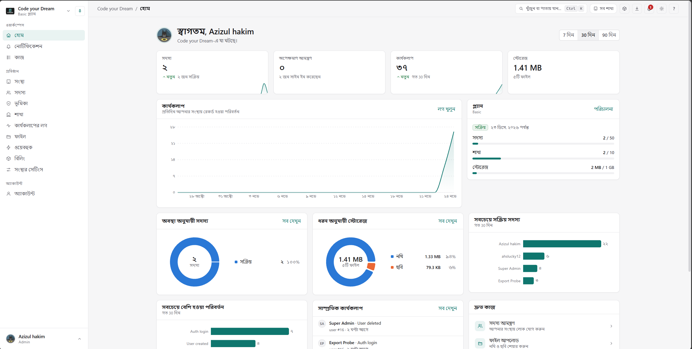
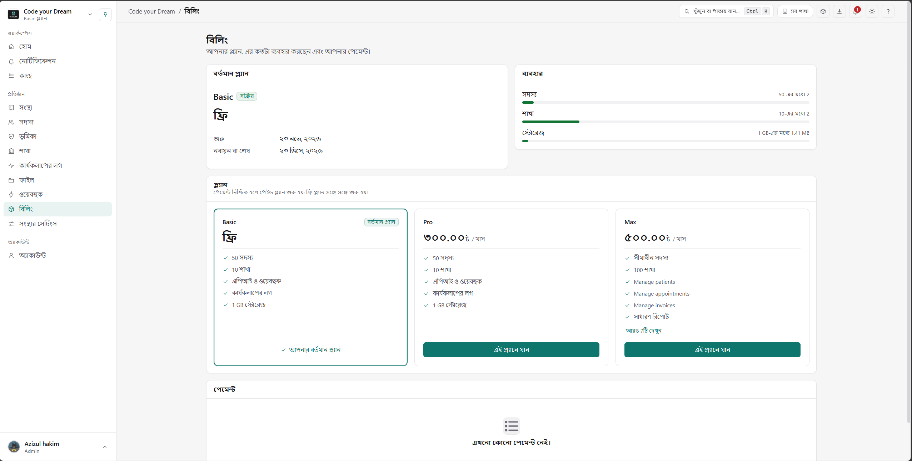

The app ships in **English and Bangla**, in light and dark, with five accent colours and two
densities. All of it rests on two small systems: a typed message catalog and a set of design
tokens.



## Translations

### How text works

Every visible string is a key in a catalog:

```ts title="web/app/src/i18n/en.ts"
'members.invitedToast': 'Invitation sent to {email}.',
```

```tsx
const t = useT()
push(t('members.invitedToast', { email }), 'success')
```

- `en.ts` is the **reference** catalog. `bn.ts` is typed `Messages`, so TypeScript refuses a
  build where Bangla is missing a key (or has one English doesn't).
- `{name}` placeholders are filled from the second argument. Write sentences that work for any
  value ("Invitation sent to {email}.") rather than building them from pieces, and avoid
  plural-dependent wording ("{count} files" reads fine as "Files: {count}").
- The language is chosen per browser (the account menu), first from the browser's own language.
  It sets `<html lang>`, and every API call sends it as `Accept-Language`.

### The server speaks the same language

Because each request carries `Accept-Language`, API messages come back translated too: validation
errors, problem titles, notification texts. E-mails use the **recipient's** saved language. The
server catalogs and e-mail templates are described in [Mail and i18n](../guides/mail-and-i18n.md).

Dates, numbers and money are formatted with `Intl` for the chosen language (`bn-BD` for Bangla),
so a Bangla user sees Bangla numerals and month names: use `useMoney()` and the helpers in
`src/format.ts` rather than formatting by hand.



### Adding a language

1. Copy `src/i18n/bn.ts` to `src/i18n/<code>.ts`, rename the export and translate every value.
   Keep product names (`'app.name'`) as they are.
2. Register it in `src/i18n/index.ts`: add the code to `Locale`, an entry to `locales` (its own
   name and the `Intl` locale, e.g. `{ code: 'ar', label: 'العربية', intl: 'ar' }`) and the catalog
   to `catalogs`. Update `detect()` so a browser in that language starts in it.
3. Add the server side: messages and e-mail templates for the same code (see
   [Mail and i18n](../guides/mail-and-i18n.md)).
4. `npm --prefix web/app run typecheck` fails until every key is translated.

A right-to-left language also needs `dir="rtl"` on `<html>` (set it next to `lang` in
`applyDocument()`), and the stylesheets would need their left/right margins and paddings turned
into logical ones (`margin-inline-start` and so on): today they are written for left-to-right.

## Theming

### Tokens, not colours

Components never use a raw colour. They use **tokens** defined once in
`web/app/src/styles/tokens.css`:

| Tokens | For |
| --- | --- |
| `--surface-0` … `--surface-2`, `--surface-inset` | page, cards, raised and sunken areas |
| `--text-1` … `--text-3` | primary, secondary and muted text |
| `--border`, `--border-strong` | dividers and inputs |
| `--accent`, `--accent-fg` | the accent and text on it |
| `--ok-fg`, `--warn-fg`, `--danger-fg`, `--info-fg`, `--violet-fg` | status colours |
| `--series-1` … `--series-6` | chart series, in order |
| `--fs-xs` … `--fs-xl`, `--space-1` … `--space-6`, `--radius` | type scale, spacing, shape |

Three attributes on `<html>` select the values, set before the first paint so nothing flashes:

```html
<html data-theme="dark" data-accent="teal" data-density="compact">
```

- **Theme**: `light` or `dark`; "System" follows the operating system and resolves to one of
  them.
- **Accent**: `indigo` (default), `blue`, `teal`, `violet`, `slate`. Each preset has a light and a
  dark value.
- **Density**: `comfortable` (default) or `compact`, which tightens rows and padding.

The user's choices are stored per browser (`src/components/appearance.ts`).

### Rebranding

To give the app your brand:

1. Change the accent presets in `tokens.css` (or add one, and list it in `accents` in
   `appearance.ts`). Set the default in `appearance.ts`.
2. Adjust surfaces and text in both theme blocks if you want a different neutral.
3. Replace `web/app/public/favicon.svg` and set `'app.name'` in every catalog.
4. Run the style check.

```bash
npm --prefix web/app run check:style
```

The check fails when any text and surface pair, the accent, or a status colour on its background
falls below **WCAG AA contrast (4.5:1)** in either theme with any accent preset, when a style uses
a size outside the type scale, or when a raw colour appears outside `tokens.css`. CI runs it.

### Charts

Charts (`src/components/charts.tsx`) take their colours from `--series-1` … `--series-6` and
their text and grid from the text and border tokens, so they follow the theme without extra code.
Use `KpiCard`, `TrendChart`, `DonutChart` and `RankedBarChart` rather than raw Recharts so every
chart in the app looks the same.
