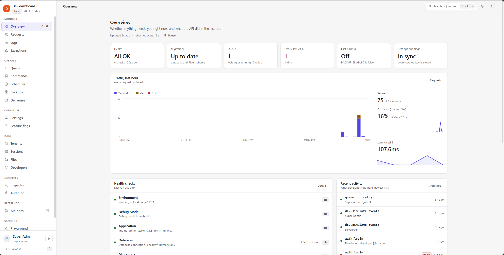
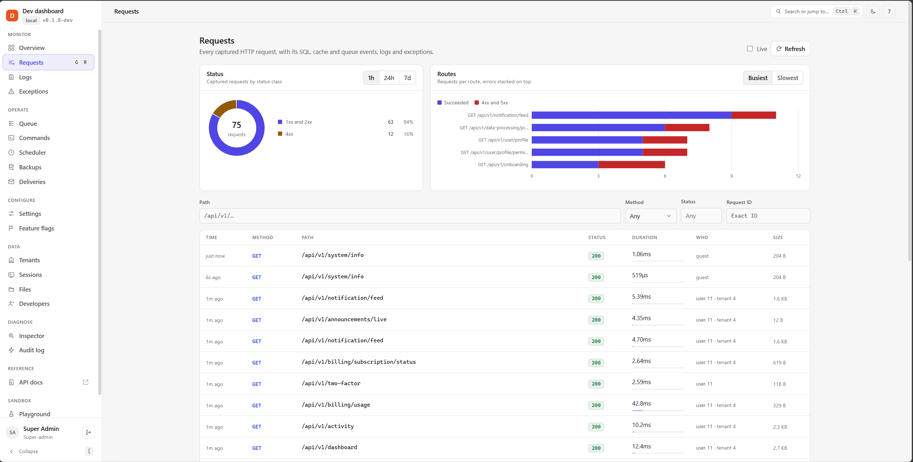

The developer dashboard is a React app **embedded in the binary** and served at `/dev`. Think of
Laravel Telescope, Horizon and a slice of Nova in one place, plus panels neither has (commands, an
inspector, tenants, settings, flags, sessions, an audit log), for the people who build and run the
API, not for your customers. [Coming from Laravel](../getting-started/coming-from-laravel.md#the-developer-dashboard)
compares them panel by panel.

## Who can open it

| Setting / permission | Effect |
| --- | --- |
| `DEV_DASHBOARD_ENABLED` | on by default outside production; off in production unless you set it |
| `dev.view` | open the dashboard and read every panel |
| `dev.manage` | anything that changes something — every such action is **audited** |

The seeded **Developer** role (`developer@ims.com`) has both; the super admin can do everything.
Without `dev.manage` the top bar shows a **Read-only** badge. Disabled deployments answer 404 at
`/dev` before any authentication. On **production** a red line runs across the top of the window
and the environment badge is red, so a change is never made on the wrong instance by mistake.

## Monitor

| Panel | Shows |
| --- | --- |
| **Overview** | whether anything needs you: health, migrations, the queue, errors in the last 24 hours, the last backup and settings or flags missing from the database (grey while all is well, each linking to its panel); every health check next to recent activity; connections in use per database pool next to the Database check; the last hour of captured traffic as a per-minute chart (2xx/3xx, 4xx, 5xx) with the error rate and p95; errors and failed jobs when there are any; the environment and the Go packages it runs on |
| **Requests** | requests by status class (1 hour, 24 hours or 7 days) and the busiest or slowest routes as charts; every captured request with a pinned summary (method, status, duration, who, request ID) and tabs for the SQL it ran (total time, slowest and repeated statements), cache calls, jobs it queued, logs, exceptions, headers and bodies (redacted) |
| **Logs** | warn-and-above log lines, the level as the row's edge, with search and a link to each line's request |
| **Exceptions** | exceptions per hour over the last day and by class as charts; panics and 5xx, grouped by class and message with a count and first/last seen, each with its stack trace and request |

## Operate

| Panel | Does |
| --- | --- |
| **Queue** | a chart of every queue's jobs (waiting or running, failed, done); one tile per queue (waiting, failed, pause/resume) and jobs by state; retry, cancel or delete a job. Shows the job envelope, never the payload |
| **Commands** | runs the allowlisted maintenance commands in-process, with options, confirmation, background runs and output history |
| **Scheduler** | every scheduled task with its cron expression in words, the next run and its last ten runs (ok, failed or interrupted, how long, the error); a **History** of every run, filtered by task and status; **Run now** (`dev.manage`, audited) does the same work as `ims schedule:run`; warns when no `ims schedule` process is checking in |
| **Backups** | runs with size, checksum and destinations; run, clean, download (`dev.manage`) |
| **Deliveries** | deliveries per day by outcome and by channel as charts (7, 14 or 30 days); the [delivery log](../guides/delivery.md) (mail, SMS, push: template, masked address, status, error — never a body) with filters and a drawer per message, and a **Templates** tab that previews each template per channel and language with its sample data |

## Configure

| Panel | Does |
| --- | --- |
| **Settings** | every setting with its global value and per-tenant overrides; inline edit; drag keys between groups and reorder groups |
| **Feature flags** | every flag per target (global, tenant, user) with a rollout slider |

## Data

| Panel | Does |
| --- | --- |
| **Tenants** | every tenant with its plan, usage against limits and override counts; deep links to its settings and flags |
| **Sessions** | active tokens by last use as a chart; active tokens per user; revoke one, a user's, or all |
| **Files** | storage by type and by disk as charts (size or count); every file across disks with thumbnails, previews (images, PDFs) and filters |
| **Developers** | who has dashboard access; grant or remove the Developer role |

## Diagnose

| Panel | Does |
| --- | --- |
| **Inspector** | **System** (the [maintenance mode](../guides/maintenance-mode.md) toggle, health checks + runtime, and the database connection pools read live), **Routes** (every route with its middleware and permission; the same table as `ims route:list`), **Roles & permissions** (catalog vs database drift), **Config** (effective values, secrets masked), **Packages** (Go and npm dependencies) |
| **Audit log** | every dashboard action and sign-in (including failures — never the password) with IP and browser; filter by action, person, status and date |

## Sandbox (local only)

**Playground** enqueues sample jobs and writes sample logs and exceptions, so every panel can be
seen populated without real traffic. **Component kit** (`/dev/kit`) shows every dashboard component
in every tone: the reference for new panels and the page to check a theme against.

## Keyboard

Press **?** for the full list. Letter keys work in either case. Shortcuts do nothing while you type in a field.

| Keys | Does |
| --- | --- |
| **Ctrl K** (⌘K) | the command palette: any panel, Inspector tab, command or record |
| **G** then a letter | open a panel (**G O** Overview, **G R** Requests, **G Q** Queue, **G H** Scheduler, …; the keys show when you hover a panel in the sidebar) |
| **/** | focus the panel's search or filter box |
| **R** | refresh what is on screen |
| **[** | collapse or expand the sidebar |
| **Esc** | close the top dialog, drawer or menu |

## Appearance

The top bar's appearance menu sets the **theme** (system, light or dark), the **accent** colour
(indigo, blue, teal, violet or slate) and the **density** (comfortable or compact). The choice is
kept per browser and applied before the page paints, so there is no flash of the wrong theme. A
project built on the kit changes the default accent, or adds its own, in one place:
`web/dev/src/styles/tokens.css`. Every colour, size and radius is a token there, and
`npm run check:style` (also in CI) checks that every text colour passes WCAG AA in both themes and
with every accent.

## How it is built

- The SPA lives in `web/dev` (React, TanStack Router and Query, cmdk for the palette) and is
  embedded with `go:embed`; release builds include it, so production needs no Node.
- Its JSON API is `/dev/api/*` (`internal/modules/dev`), documented in `api/openapi.yaml` like the
  rest of the API. `GET /dev/api/overview` builds the Overview in one call from the same code paths
  the panels use.
- Handlers call panel services (`services.go`, `inspector.go`, `commands.go`, `overview.go`); every
  mutation is recorded in `dev_actions`, kept for `DEV_DASHBOARD_AUDIT_RETENTION_DAYS` (default 180).
- Telemetry comes from the collector described in
  [Health & observability](../guides/health-and-observability.md#telemetry-the-dashboard).

To add a panel, command or palette entry, see [Extending the dashboard](./extending.md).
