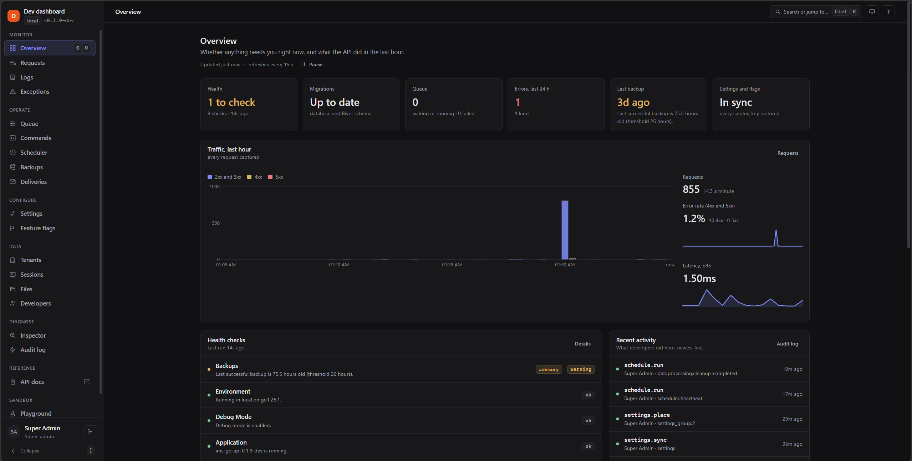

**Laravel's batteries and workflow. Go's runtime, without the magic.**

That line is the whole design, and each part means something specific:

- **Laravel's batteries.** The features a Laravel app reaches for are already here, under names you
  know: auth with tokens, queues, a scheduler, cache drivers, storage disks, mail, an activity log,
  roles and permissions, settings, maintenance mode, a Telescope-style dashboard.
- **Laravel's workflow.** Thin controllers, form requests, `can:` middleware on routes, services,
  artisan commands, feature tests. You can guess where things live.
- **Go's runtime.** One static binary that runs everything, as a process that stays running.
- **Without the magic.** No ORM, no service container, no facades, no global scopes, no model
  events. Everything is wired explicitly in code you can read, and the compiler checks it.

So it is not "Laravel ported to Go". It keeps what Laravel gets right about **building** an
API, and changes **how it is built** wherever Go has a better answer. This page maps one to the
other.

## What we take from Laravel

### The workflow

| Laravel | Here | What's different |
| --- | --- | --- |
| Controller method | handler method on a type embedding `httpx.Kit` | same shape: bind, call a service, respond |
| Form request, `$request->validated()` | `h.Bind(w, r, &req)` + `validate:"…"` struct tags | same 422 with field errors; database rules (`unique`, `exists`) live in the service |
| `->middleware('can:x')`, `Gate::before` for super-admins | `r.With(h.can("x"))`, super-admin bypass in `authz.Checker` | a CI test fails any route without a permission |
| `auth()->id()` | `authn.UserID(r)` | |
| Service classes | services: rules, tenancy, transactions, activity | callable from HTTP, CLI, jobs and the scheduler alike |
| `config/*.php` + `.env` | `internal/config/*.go`, one file per section, + `.env` | typed and validated at startup |
| `DB::transaction()` | `s.tx.WithTx(ctx, func(q *dbgen.Queries) error { … })` | |
| `make:model -a` | `ims gen module --name=… --fields=…` | writes migration, SQL, model, repository, service, handler, routes, OpenAPI and a test |
| Feature tests, `actingAs($user)` | `testkit.New(t)`, `app.As(user).Post(…).Status(t, 201)` | a real Postgres schema per test package |
| `Kernel::schedule()` | the task list in `internal/app/schedule.go` | |

### Artisan → `ims`

The binary is the CLI, with the same `area:verb` naming ([CLI commands](../guides/cli-commands.md)):

| `php artisan` | `ims` |
| --- | --- |
| `serve` | `serve` |
| `migrate`, `migrate:status`, `migrate:rollback` | the same |
| `db:seed` | `db:seed` |
| `queue:work` | `queue:work` |
| `schedule:work`, `schedule:list`, `schedule:run` | `schedule`, `schedule:list`, `schedule:run <task>` |
| `cache:clear` | `cache:clear` |
| `key:generate` | `key:generate` (writes `APP_KEY` to `.env`) |
| `down --secret --retry`, `up` | `down --secret --retry`, `up` ([maintenance mode](../guides/maintenance-mode.md)) |
| `about`, `config:show` | `config:show`, and the dashboard's **About** command |
| `route:list` (`--method`, `--path`, `--except-path`, `--json`, `-v`) | `route:list` (the same flags, `--middleware` for `-v`), with each route's permission; also the dashboard's **Inspector → Routes** |
| `make:*` | `gen module`, `gen openapi` |

### The packages you would install

| In Laravel | Here |
| --- | --- |
| Sanctum (personal access tokens) | opaque per-device tokens, hashed at rest ([Authentication](../guides/authentication.md)) |
| Socialite | Google and GitHub sign-in, as small drivers ([Social login](../guides/social-login.md)) |
| Fortify (two-factor) | two-factor by authenticator app or e-mail code, with recovery codes ([Two-factor](../guides/authentication.md#two-factor-authentication)) |
| spatie/laravel-permission | the permission catalog, roles per tenant, `permission:sync` ([Permissions](../guides/permissions.md)) |
| Notifications, Mailables (mail, SMS, push) | one delivery system with templates per channel and language, and notification preferences ([Delivery](../guides/delivery.md), [Notifications](../guides/notifications.md)) |
| spatie/laravel-webhook-server | outbound webhooks fed by the activity log ([Webhooks](../guides/webhooks.md)) |
| spatie/laravel-activitylog | `activity.Recorder` and a system audit log ([Activity log](../guides/activity-log.md)) |
| spatie/laravel-settings, Pennant | typed settings per tenant, feature flags with percentage rollout ([Settings](../guides/settings.md), [Feature flags](../guides/feature-flags.md)) |
| spatie/laravel-medialibrary | files attached to owners, on any disk ([Files and storage](../guides/files-and-storage.md)) |
| spatie/laravel-backup | `backup:run`, retention, S3/R2 copies ([Backups](../operations/backups.md)) |
| spatie/laravel-health | `/api/health`, with the same `checkResults` payload ([Health](../guides/health-and-observability.md)) |
| Horizon, Telescope | the [developer dashboard](#the-developer-dashboard) |
| Cashier | plans with feature limits and local gateways (bKash, cash, bank transfer) ([Billing](../guides/billing.md)) |

## What we take from Go

- **One binary, no stack around it.** The same `ims` binary serves HTTP, runs queue workers and the
  scheduler, applies migrations and embeds the dashboard. No PHP-FPM, nginx, Supervisor or cron to
  assemble: three systemd units (API, worker, scheduler) running the same binary
  ([Deploy](../operations/deploy.md)), or Docker if you prefer.
- **A process that stays running.** Laravel boots the framework on every request (unless you run
  Octane). Here the process keeps state between requests: permission, settings and tenancy lookups
  are cached in it, and maintenance mode costs no query per request.
- **Types and the compiler.** sqlc turns SQL into typed Go, so a wrong column is a build error
  instead of a 500 in production. CI checks the OpenAPI contract against the real routes, and
  generated code and reference pages against their sources.
- **Concurrency built in.** Context-based timeouts and cancellation on every request and query,
  graceful shutdown, background dashboard commands in goroutines, a Postgres-backed queue (River).
- **Errors are values.** Services return `*apperr.Error`; one renderer turns every error into an
  RFC 9457 problem response.

## What we leave out on purpose

Laravel's "magic" makes small apps fast to write and big apps hard to follow. Each piece has an
explicit replacement here:

| Laravel magic | Here | Why |
| --- | --- | --- |
| Eloquent models, relationships | SQL in `sql/queries/*.sql`, typed by sqlc; repositories | you read the exact query; no N+1 surprises |
| Global scopes (`TenantAware`) | an explicit tenant filter in every tenant-scoped query | a forgotten filter matches **no** rows instead of leaking another tenant's ([Tenancy](../guides/tenancy.md)) |
| Service container, providers, auto-wiring | one composition root: `internal/app/platform.go` and `wiring.go` | every dependency is a visible constructor call |
| Facades (`Cache::`, `DB::`) | dependencies passed to constructors, optional ones via `WithX(…)` | tests swap a fake without mocking statics |
| Model events, observers | the service calls what it needs (`s.activity.Record(…)`), or a small interface (`authn.LoginAudit`) | the side effects of a change are in the method that makes it |
| Exceptions | errors returned as values | every failure path is visible at the call site |

## What you will miss

Honest trade-offs, so they don't surprise you:

1. **No ORM.** No relationships, eager loading, accessors or `$model->save()`. You write SQL and a
   repository method. `ims gen module` writes the first version for you.
2. **More lines per feature.** Explicit errors, request and response types, mappers. The generator
   and the patterns keep it predictable, not short.
3. **Wiring by hand.** A new shared service is constructed in `platform.go` and put on `Platform`;
   nothing is discovered for you (a test catches a missed assignment).
4. **Validation tags are simpler than rules.** Formats and ranges are tags; anything that needs the
   database is a check in the service.
5. **Not built:** events and listeners as a pattern, broadcasting, Blade (this is an API),
   per-model policies (permissions are on routes), `tinker`.

## The developer dashboard

Laravel splits this across Telescope, Horizon and an admin panel you build yourself. Here it is
**one app, embedded in the binary**, at `/dev` ([Dashboard tour](../dashboard/overview.md)).

**From Telescope:** every request with its headers and (redacted) bodies, and on the same screen
the SQL it ran, its cache calls, the jobs it queued, its logs and exceptions. Plus searchable logs
and an exceptions list with stack traces.

**From Horizon:** queues and jobs by state, pause and resume a queue, retry, cancel or delete a
job. (No throughput or wait-time charts.)

It looks the way you set it: light, dark or the system's theme, your accent colour, and a
keyboard shortcut for every panel (`?` lists them).

**Added here, beyond Telescope and Horizon:**

| Panel | What it gives you |
| --- | --- |
| **Overview** | whether anything needs you right now: health, migrations, queue, errors, backups and settings drift, and the last hour of traffic as a chart |
| **Scheduler** | every scheduled task with its next run and a history of every run (what `schedule:list` prints, plus whether each run worked); run one now |
| **Commands** | run allowlisted maintenance commands from the browser, with options, confirmation, background runs and output history: artisan, audited |
| **Inspector** | system health and the **maintenance mode** toggle, every route with its middleware and permission (what `ims route:list` prints), roles vs the permission catalog, the effective config with secrets masked, dependencies |
| **Audit log** | every dashboard action and sign-in, with IP and browser |
| **Tenants** | every tenant with its plan and usage against limits |
| **Sessions** | active tokens per user; revoke one, a user's, or everyone's |
| **Settings** and **Feature flags** | edit values globally or per tenant; percentage rollout |
| **Files** | every stored file, with previews |
| **Backups** | runs, sizes, destinations; create, clean, download |
| **Developers** | who has dashboard access |
| **Ctrl+K** | jump to any panel, record or command |

A red **Maintenance** pill shows on every page while the API is down.

## Where to go next

- [How it works](./how-it-works.mdx): one request from the route to the SQL.
- [Build your first module](../tutorial/first-module.mdx): the workflow end to end.
- [Design decisions](../architecture/decisions.md): every deliberate trade-off and its reason.
