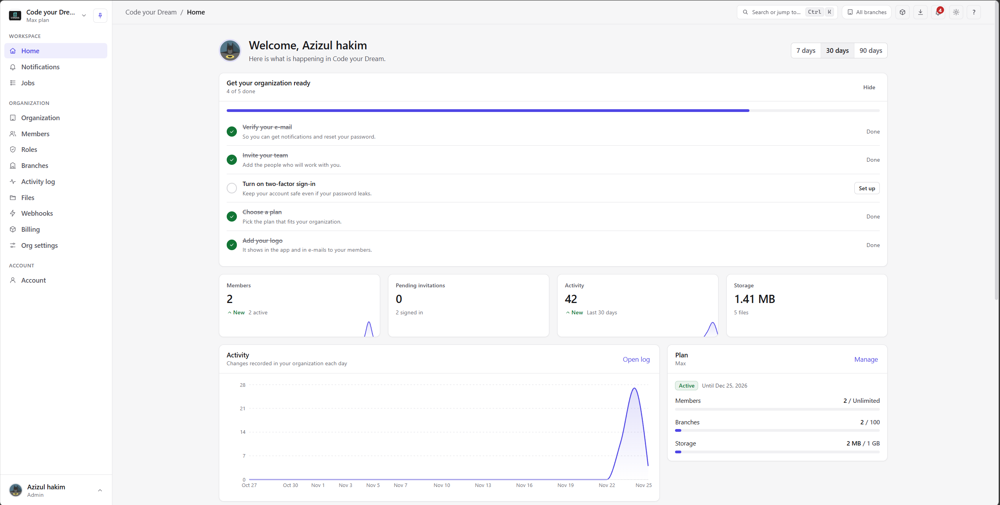
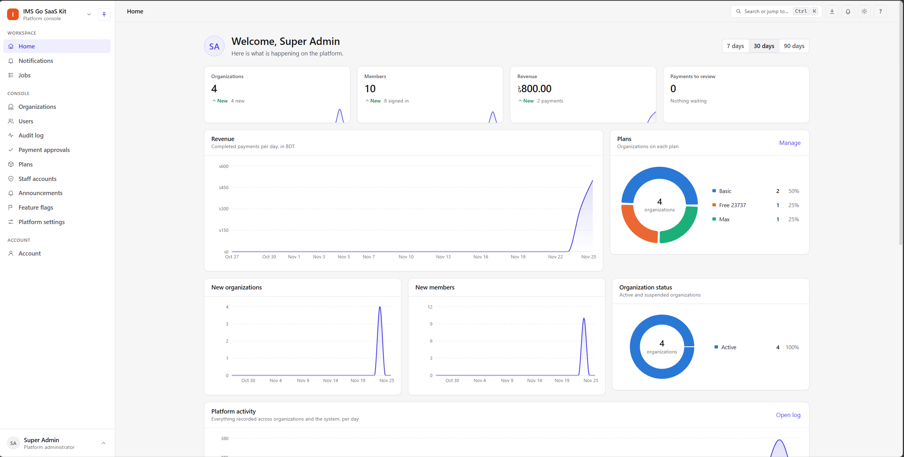

IMS Go SaaS Kit is a **multi-tenant SaaS you start from instead of a blank page**. It is a working
product with three parts, all served by one Go binary:

- **The app** at `/`: a React app with a workspace for each organization that signs up (members,
  roles, branches, billing, files, webhooks, activity) and a console for your staff
  (organizations, plans, payment approvals, announcements, feature flags, audit). Six
  languages (Arabic right to left), light and dark. See [The app](../app/overview.md).
- **The API** at `/api/v1`: everything the app does, as a documented HTTP API with an OpenAPI 3
  contract checked against the code. Authentication with two-factor, tenants and branches, roles
  and permissions, billing with plan limits, notifications, files, webhooks, a queue and a
  scheduler.
- **The developer dashboard** at `/dev`: live requests with their SQL, logs, exceptions, the
  queue, schedules, deliveries and one-click maintenance commands (think Laravel Telescope plus
  Horizon).

The same `ims` binary also serves the API reference at `/docs`, an MCP connector for AI agents at
`/mcp`, and runs migrations, queue workers and the scheduler. No containers required;
Docker-ready when you want it.

| Organization workspace | Staff console |
| --- | --- |
|  |  |

## Who it is for

- **Teams building a SaaS or an internal platform** that serves many organizations, each with
  branches, members and roles, and that need a staff side to run it.
- **Laravel developers moving to Go** who want Go's runtime and deployment story without giving up
  the conventions they rely on: controllers, form requests, `can:` middleware, artisan commands,
  queues, scheduled tasks, feature tests. [Coming from Laravel](./coming-from-laravel.md) maps each
  one, and says what you will miss.
- **Go developers** who want a codebase where every concern has an obvious home and the "boring"
  parts (errors, pagination, tenancy, audit trails, sign-up, billing screens) are already decided.

## What you get

| Area | Highlights |
| --- | --- |
| The app | organization workspace and staff console, sign-up and a setup wizard, Ctrl+K and keyboard shortcuts, live updates, a jobs tray, accent and density presets, phone layouts, six languages including Arabic right to left |
| Identity | opaque tokens per device, OTP, two-factor by authenticator app or e-mail code, invitations, sessions users can see and revoke, login throttling, password reset, e-mail verification, Google and GitHub sign-in, every login in the activity log |
| Tenancy | organizations and branches, explicit `tenant_id` filters that fail closed, staff impersonating an organization or logging in as a user (audited), public tenant routes |
| Access | a permission catalog in Go, roles per organization, Super-Admin, a check on every route, an organization activity log and a system audit log |
| Billing | plans with features and limits, subscriptions, bKash, cash and bank payments, staff approvals |
| Product | settings, feature flags with rollout, notifications by feed, mail, SMS and push, announcements, import and export |
| Integrations | outbound webhooks (signed, retried, logged), an MCP server AI agents add as a connector, with built-in OAuth |
| HTTP | chi router, RFC 9457 problem errors, envelopes, pagination, rate limiting, duplicate-write protection with `Idempotency-Key`, OpenAPI as the contract |
| Data | sqlc type-safe SQL, goose migrations, transactions, advisory-lock quotas, files on local, S3, R2 or MinIO |
| Ops | health probes, Prometheus metrics, OpenTelemetry tracing, backups, systemd deploy with gated migrations, rollback, maintenance mode |
| DX | `ims gen module`, `make rename`, `testkit`, hot reload for Go and both web apps, typed API clients generated from the spec, AI-agent skills |

## The ideas behind it

1. **Start from a product.** Sign-up, onboarding, a workspace per organization, billing and a
   console already work together. Your work is the part that makes your product different.
2. **Explicit over magic.** No ORM, no global scopes, no reflection-driven wiring on the server;
   no global state library in the app. You can follow a click from the screen to the SQL without
   guessing.
3. **One direction of data flow.** Screen → API client → route → handler → service → repository
   → generated SQL. Each layer has one job. See [How it works](./how-it-works.mdx).
4. **Fail closed.** A forgotten tenant filter matches no rows. A route without a permission fails
   CI. The app hides what you can't do, and the API refuses it anyway.
5. **The code is the source of truth.** The OpenAPI spec, the generated SQL code, the app's API
   types and these reference pages are checked in CI against the code, so they cannot quietly
   drift.

The full list of deliberate trade-offs, including what was *not* built and why, is in
[Design decisions](../architecture/decisions.md).

## What it is not

- **Not a framework.** It is an application you copy and own. Change anything; `make rename`
  gives it your names ([Make it yours](./make-it-yours.md)).
- **Not database-agnostic.** PostgreSQL only, on purpose (see decision 22).
- **Not a design system.** The app is styled with plain CSS on design tokens, which you can
  rebrand in one file, but it isn't a component library to install elsewhere.

Ready? Head to the [Quick start](./quick-start.mdx).
