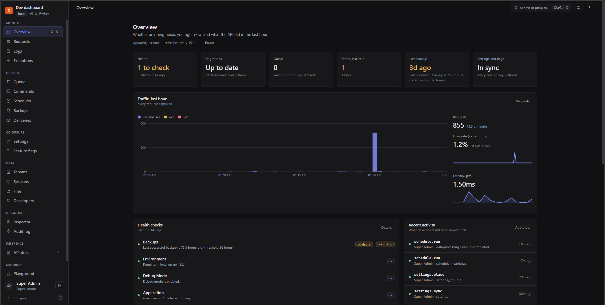

import { Steps, Tabs, TabItem, Aside } from '@astrojs/starlight/components'
import Terminal from '@components/Terminal.astro'

## Prerequisites

| Tool | Version | Why |
| --- | --- | --- |
| Go | 1.26.11 or newer | builds and runs the API |
| PostgreSQL | 16 or newer | the only database (local install, Docker, or a managed one) |
| Node.js | 20.19+ (22.23+ for the docs site) | builds the developer dashboard |
| make | any GNU make | shortcuts; every target is also a plain `go` command |

<Aside type="tip" title="Docker is optional">
  The steps below run the app natively; Postgres can be one you already run (Homebrew, a Windows
  installer, a stack manager — point `DATABASE_DSN` at it) or `make db-up`, a throwaway one in
  Docker. Prefer containers for everything? `docker compose up -d --build` runs Postgres,
  migrations, the API, the worker and the scheduler from one image — see
  [Docker](../operations/docker.md).
</Aside>

## Run it

<Steps>

1. **Make it your repository.** On GitHub, press **[Use this template](https://github.com/Innovix-Matrix-Systems/ims-go-api-starter/generate) → Create a new repository**.
   You get your own repository with a clean history, not a fork that points back here. (Just
   trying it out? Clone this repository directly.)

2. **Clone and configure.** Copy the example environment; every value has a working local default.

   ```bash
   git clone <your-repository-url> ims-go-api && cd ims-go-api
   cp .env.example .env
   make key-generate      # writes APP_KEY to .env
   ```

   `APP_KEY` encrypts what the app must read back (two-factor secrets, codes in queued jobs).
   Locally an empty key falls back to a public development key with a warning; staging and
   production refuse to start without a real one.

3. {/* rename:keep */}**Give it your names.** One command rewrites the starter's names everywhere: the Go module
   path, the binary and CLI (`ims` → `shop`), the deploy names and paths, the display title and
   the `IMS_` deploy variables. It also renames the systemd units and regenerates the code and docs.
   It refuses to run with uncommitted changes, so the rename is one reviewable commit.

   ```bash
   make rename MODULE=github.com/acme/shop-api DRY=1                            # preview
   make rename MODULE=github.com/acme/shop-api BINARY=shop TITLE="Acme Shop"   # NAME, BINARY, TITLE are optional
   git add -A && git commit -m "chore: rename the starter to shop-api"
   ```

   `NAME` defaults to the last part of the module (`shop-api`), `BINARY` to the name, and `TITLE`
   to the name in title case (`Shop API`). Left as they are: the seeded `@ims.com` accounts and the
   credit links. Run it once; it refuses a project that has already been renamed. The commands
   below use the starter's names: substitute yours.
   {/* rename:end */}

4. **Install the tools once.** `air` (hot reload) and `golangci-lint`, then the dashboard's
   packages.

   ```bash
   make tools
   npm --prefix web/dev ci
   ```

5. **Start Postgres** — skip this if you already have one running.

   ```bash
   make db-up        # docker compose: creates ims_go_api and ims_go_api_test
   ```

6. **Create the schema and seed data.** Migrations first, then permissions, the default tenant,
   roles and two accounts.

   ```bash
   make migrate seed
   ```

7. **Run everything with hot reload.**

   ```bash
   make dev
   ```

</Steps>

<Terminal
  title="make dev"
  lines={[
    { cmd: 'make migrate seed' },
    { out: 'goose: successfully migrated database to version: 34', tone: 'dim' },
    { out: 'River schema: v8 (0 pending)', tone: 'dim' },
    { out: 'seeded permissions, tenant "Default", roles Admin + Developer', tone: 'ok' },
    { out: 'accounts: superadmin@ims.com, developer@ims.com', tone: 'ok' },
    { cmd: 'make dev' },
    { out: 'vite  → http://localhost:8080/dev/', tone: 'accent' },
    { out: 'air   → building ./cmd/app … running on :8081', tone: 'dim' },
    { out: 'http server listening addr=:8081 env=local', tone: 'ok' },
  ]}
/>

## Look around

Open **[localhost:8080/dev/](http://localhost:8080/dev/)** and sign in:

| Account | E-mail | Password | Can |
| --- | --- | --- | --- |
| Super Admin | `superadmin@ims.com` | `123456` | everything, every tenant |
| Developer | `developer@ims.com` | `123456` | the developer dashboard |

The password comes from `AUTH_DEFAULT_PASSWORD`. The API reference (Scalar, from
`api/openapi.yaml`) is at **[localhost:8080/docs](http://localhost:8080/docs)**.



Call the API from a terminal. Sign in and use the system side with just the token, the way an
admin panel does:

<Tabs>
<TabItem label="bash">

```bash
TOKEN=$(curl -s localhost:8080/api/v1/login -H 'Content-Type: application/json' \
  -d '{"email":"superadmin@ims.com","password":"123456","device":"cli"}' | jq -r .data.token)
AUTH=(-H "Authorization: Bearer $TOKEN")

curl -s localhost:8080/api/v1/tenant "${AUTH[@]}" | jq    # system panel: every tenant
curl -s localhost:8080/api/v1/branch "${AUTH[@]}" | jq    # a tenant resource, read across all tenants
```

</TabItem>
<TabItem label="PowerShell">

```powershell
$login = Invoke-RestMethod http://localhost:8080/api/v1/login -Method Post `
  -ContentType 'application/json' -Body '{"email":"superadmin@ims.com","password":"123456","device":"cli"}'
$auth = @{ Authorization = "Bearer $($login.data.token)" }

Invoke-RestMethod http://localhost:8080/api/v1/tenant -Headers $auth    # system panel: every tenant
Invoke-RestMethod http://localhost:8080/api/v1/branch -Headers $auth    # a tenant resource, read across all tenants
```

</TabItem>
</Tabs>

To work **inside one tenant**, add the acting headers. Reads narrow to that tenant, and writes to
tenant resources need them (without them the super admin gets 403):

<Tabs>
<TabItem label="bash">

```bash
ACT=(-H "X-Acting-Tenant: 1" -H "X-Acting-Branch: 1")

curl -s localhost:8080/api/v1/branch "${AUTH[@]}" "${ACT[@]}" | jq    # tenant 1 only
curl -s localhost:8080/api/v1/branch "${AUTH[@]}" "${ACT[@]}" \
  -H 'Content-Type: application/json' -d '{"name":"Uptown"}' | jq      # a write inside tenant 1
```

</TabItem>
<TabItem label="PowerShell">

```powershell
$act = $auth + @{ 'X-Acting-Tenant' = '1'; 'X-Acting-Branch' = '1' }

Invoke-RestMethod http://localhost:8080/api/v1/branch -Headers $act    # tenant 1 only
Invoke-RestMethod http://localhost:8080/api/v1/branch -Method Post -Headers $act `
  -ContentType 'application/json' -Body '{"name":"Uptown"}'          # a write inside tenant 1
```

</TabItem>
</Tabs>

<Aside title="When does the super admin send acting headers?">
  Only to work inside one tenant, or as one user. Signing in and the system routes (tenants, internal
  users and roles, packages, internal settings, the system audit log) never use them, and reads
  of tenant resources without them span every tenant.

  - `X-Acting-Tenant` (+ `X-Acting-Branch`): **view or work inside one tenant**, still as yourself.
    Writes to tenant resources need both.
  - `X-Acting-User: <user id>`: **act as one user**, with their permissions, tenant and branch.
    Every request is recorded in the system audit log.

  A tenant user never sends any of them: their tenant comes from their account. See
  [Tenancy](../guides/tenancy.md#how-a-request-is-resolved).
</Aside>

## Background work

Queue jobs (mail, imports, backups) and scheduled tasks run in their own processes. Start them in
two more terminals when you need them:

```bash
make queue       # ims queue:work
make schedule    # ims schedule
```

## Next steps

- Understand the request path: [How it works](./how-it-works.mdx).
- Find your way around the folders: [Project tour](./project-tour.mdx).
- Build something: [Your first module](../tutorial/first-module.mdx).
- Let an AI agent use your API: [Connect an AI agent](../tutorial/connect-an-ai-agent.mdx).
- Something not working? [Local development & troubleshooting](../operations/local-development.md).
