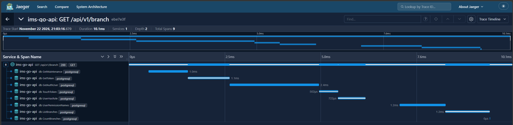
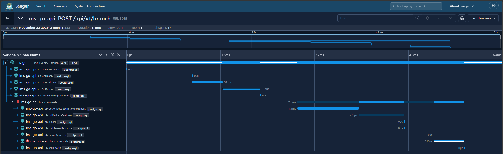
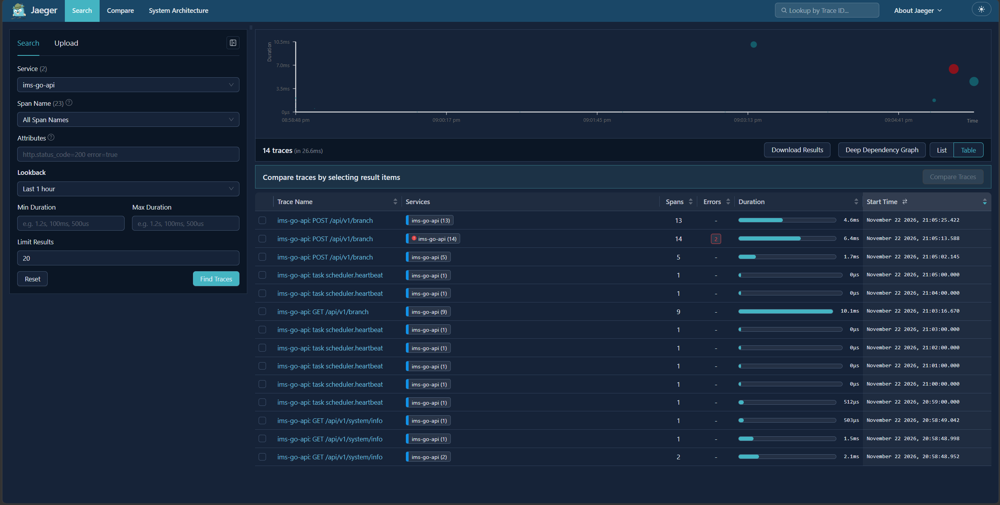

## Health checks

| Endpoint | Purpose | Answers |
| --- | --- | --- |
| `GET /up` | **liveness** — is the process up? | always `200 {"status":"ok"}` |
| `GET /api/health` | **readiness** — can it serve traffic? | `200`, or `503` when a critical check fails |

`/api/health` runs a registry of checks:

| Check | Critical? |
| --- | --- |
| environment, debug mode, application | yes |
| database (every connection), migrations + River schema | yes |
| cache, queue tables | yes |
| scheduler heartbeat | advisory |
| backups freshness (when enabled) | advisory |

Advisory checks report problems without making the API unready. Results are cached for 30
seconds so a public endpoint can't be used to amplify load; `?fresh=1` from loopback forces a run.
Load balancers and deploy scripts read the **status code**, so readiness fails closed.

```bash
ims health:check      # the same checks from the CLI
```

The dashboard's **Inspector → System** tab shows every check, the runtime (version, Go, uptime)
and re-runs them on demand.

### Maintenance mode

While the app is down for [maintenance](maintenance-mode.md) (`ims down`), `/up` and
`/api/health` keep their status codes: the process is healthy, just closed, so load balancers
and supervisors neither restart nor drop the servers. `/api/health` adds a block that monitoring
can alert on:

```json
"maintenance": {"down": true, "since": "2026-11-22T02:00:00Z", "message": "Upgrading", "retry_after": 120}
```

While up it is `"maintenance": {"down": false}`. The dashboard shows a red **Maintenance** pill
on every page and the toggle on **Inspector → System**.

## Metrics

With `METRICS_ENABLED=true`, `GET /metrics` serves a small, dependency-free Prometheus exporter:
request counts and latency by **method, route pattern and status** — low cardinality by design (no
ids, no raw paths). Protect it with `METRICS_TOKEN` (bearer); unset, it answers loopback only.

## Tracing (OpenTelemetry)

Traces go out over OTLP to any OpenTelemetry backend: Grafana Tempo, Jaeger, Honeycomb, Datadog,
New Relic or an OpenTelemetry Collector. Tracing is **off** until an endpoint is set. Until then
every span is a no-op and costs nothing.

```dotenv
OTEL_EXPORTER_OTLP_ENDPOINT=http://localhost:4318   # OTLP/HTTP; set = tracing on
OTEL_EXPORTER_OTLP_HEADERS=x-honeycomb-team=KEY     # backend auth, if any
```

The standard `OTEL_*` variables apply as the SDK defines them: `OTEL_SERVICE_NAME` (default
`APP_NAME`), `OTEL_RESOURCE_ATTRIBUTES`, `OTEL_TRACES_SAMPLER` (set, it replaces the app's
sampler) and `OTEL_SDK_DISABLED`. `OTEL_TRACES_SAMPLER_ARG` on its own sets the app's ratio.
`OTEL_ENABLED=true` turns tracing on without an endpoint, so the exporter uses its default
`localhost:4318`.

**Sampling.** By default the app keeps 10% of new traces (parent-based). A `traceparent` that
comes through a trusted proxy (`HTTP_TRUSTED_PROXIES`) is continued, and is kept when it is
sampled. So a trace that starts at your gateway or in another service carries on here. From
any other caller the request starts a new trace with a link to the caller's, so an outside
client cannot choose what gets kept. Raise the share with `OTEL_TRACES_SAMPLER_ARG=1` while
you look into something.

**What is traced without any module code:**

| Span | Named | Notes |
| --- | --- | --- |
| every HTTP request | `POST /api/v1/branch` (the route pattern) | user, tenant and impersonator ids; 5xx marks the span failed |
| SQL | `db CreateBranch` (the sqlc query name) | the statement, never its arguments; only inside a trace |
| queue jobs | `job webhook.deliver` | a child of the request that queued it, even on another process; the last failed attempt marks it |
| scheduled tasks | `task webhook.prune` | a failed run marks the span |
| outbound HTTP | `POST hooks.example.com` | webhooks, Twilio SMS, bKash, social sign-in, MCP client metadata; passes `traceparent` on |
| panics | an `exception` event with the stack | on the request's span |

One request in Jaeger: the route-named server span, then every query it ran, timed. The sign-in
check (`GetToken`, `GetAuthUser`, `UserPermissionNames`) comes before the handler's own
`ListBranches` and `CountBranches`.



**Spans of your own.** Wrap a step that is worth seeing on its own (a charge, an import, a call
to another system). The branches service (`branches.create`, `branches.update`) and billing
(`billing.subscribe` with a child `billing.charge`) are the examples:

```go
ctx, span := tracing.Start(ctx, "invoices.issue", attribute.Int64("tenant.id", tenantID))
defer span.End()
…
if err != nil {
	return nil, tracing.Fail(ctx, err) // marks the span failed, returns err
}
```

Pass the returned `ctx` on, so queries and jobs inside the step join it. Keep attributes to ids
and enums. Never put personal data or secrets on a span.

Here `branches.create` groups the work of creating a branch under the request: the plan-limit
check, the transaction with its advisory lock and count, and the insert. That insert failed (the
branch name was taken), so the query span and `branches.create`, through `tracing.Fail`, are
marked red, followed by the `ROLLBACK`. The request answered `409`: the caller's mistake, so the
server span itself is not marked failed.



**Logs and traces.** While tracing is on, every log line written inside a span also carries
`trace_id` and `span_id`, the OpenTelemetry ids, so a log search leads to the trace and back.
`request_id` stays as it is. The `trace_id` of a 5xx problem body is the request id; that is the
API's contract and does not change.

**Metrics stay Prometheus** (`/metrics` above). Most teams scrape Prometheus and send traces over
OTLP, and both meet in Grafana: the route label on a metric matches the span name.

**Local backend.** The compose file has an `otel` profile that runs [Jaeger](https://www.jaegertracing.io)
(UI on :16686, OTLP on :4317 and :4318, traces kept in memory):

```sh
# everything in containers:
OTEL_EXPORTER_OTLP_ENDPOINT=http://jaeger:4318 docker compose --profile otel up -d
# or only Jaeger, with the app running natively (make dev):
docker compose --profile otel up -d jaeger
```

For `make dev`, put the endpoint in `.env` and restart it (settings are read at startup):

```dotenv
OTEL_EXPORTER_OTLP_ENDPOINT=http://localhost:4318
OTEL_TRACES_SAMPLER_ARG=1        # keep every trace while you look
```

Open http://localhost:16686 and pick the service `ims-go-api` (your `APP_NAME`). The list shows
every request and scheduled task, with failed ones flagged; click one for its timeline.
`ims about` (or the dashboard's **Commands → About**) reports whether tracing is on.



No Docker? Jaeger is also a single binary for Linux, macOS and Windows
([releases](https://github.com/jaegertracing/jaeger/releases)): run `jaeger` with no arguments for
the same setup. On Windows, if it fails with "An attempt was made to access a socket in a way
forbidden by its access permissions", the port is in a range Windows reserves (list them with
`netsh interface ipv4 show excludedportrange protocol=tcp`); its health check uses 13132 and
13133, so move those in a copy of Jaeger's
[default config](https://github.com/jaegertracing/jaeger/blob/v2.23.0/cmd/jaeger/internal/all-in-one.yaml)
and start it with `jaeger --config <file>`.

Prefer Grafana? The compose file keeps a commented `otel-lgtm` service (Grafana with Tempo, Loki
and Prometheus in one container, UI on :3000). Use it instead of Jaeger, not beside it: both take
ports 4317 and 4318.

**Sentry and others.** The starter sends nothing to an error tracker. Sentry, Honeycomb and
Datadog all accept OTLP, so pointing the endpoint at them is usually enough. A vendor SDK can
still be added in `internal/platform/tracing`.

## Logs

Logs are structured (`log/slog`): text locally, JSON-friendly key/values in production, written
to stdout so systemd's journal collects them (`APP_LOG_DIR` writes files instead). Every request
gets an **id** (`X-Request-ID`: a well-formed one from the client is kept, anything else is
replaced) that appears in the access
log, in every log line of that request, and as `trace_id` in 5xx problems. An access log line
looks roughly like:

```text
level=INFO msg="http request" request_id=01JD… method=POST route=/api/v1/branch status=201 duration=8.4ms user_id=3 tenant_id=1
```

`user_id` is who the request ran as. While staff act as a user (`X-Acting-User`), it is that
user, and `impersonator_id` names the staff member.

Secrets are redacted from logs and captured payloads (tokens, passwords, anything matching
`DEV_DASHBOARD_REDACT_KEYS`).

## Telemetry (the dashboard)

When the developer dashboard is enabled, a collector captures — sampled with
`DEV_DASHBOARD_SAMPLE_RATE`, bodies redacted and capped at `DEV_DASHBOARD_MAX_BODY_BYTES`:

| Category | What |
| --- | --- |
| `http` | requests: method, route, status, timing, headers, bodies; the user, tenant and branch it ran as, and the impersonator when acting as a user |
| `sql` | queries per request with timing |
| `cache` | hits, misses, writes |
| `queue` | jobs enqueued (linked to the request) |
| `logs` | warn and above |
| exceptions | panics and 5xx with stack |

Choose categories with `DEV_DASHBOARD_CAPTURE`; rows are pruned after
`DEV_DASHBOARD_RETENTION_DAYS`. See the [dashboard tour](../dashboard/overview.md).
